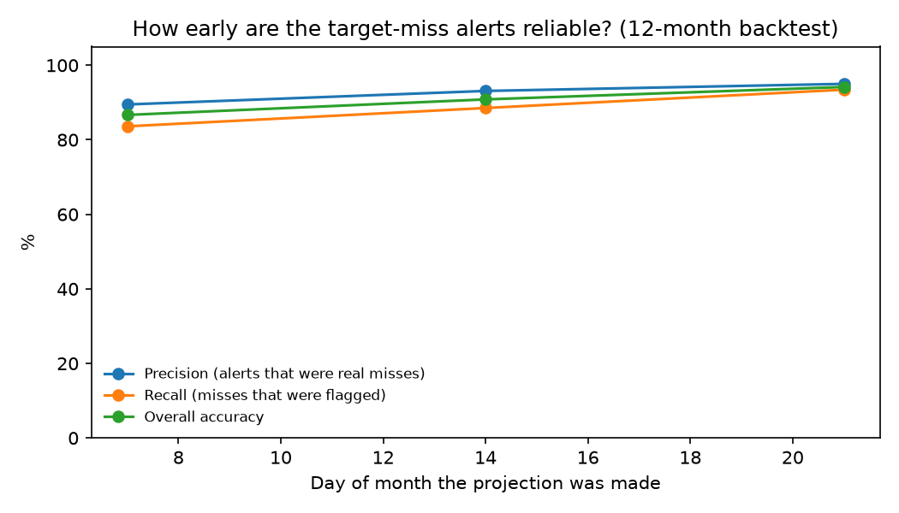
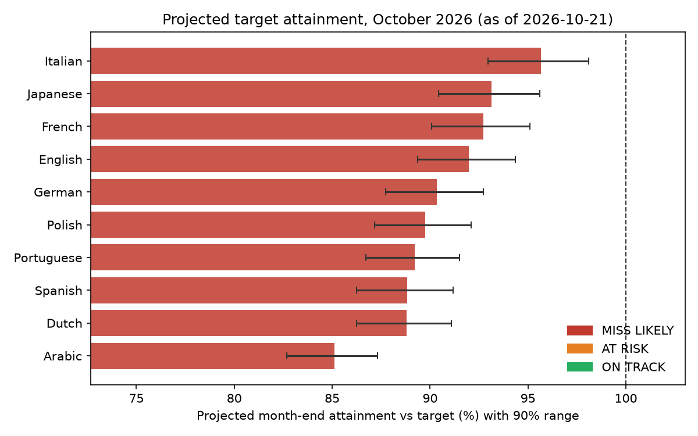
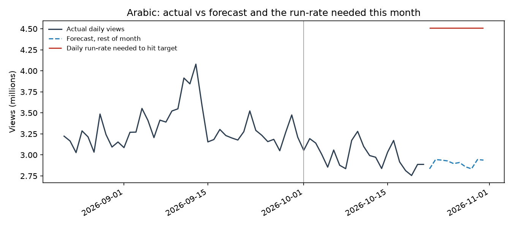

# Publisher KPI Forecasting & Target-Miss Alerts


Forecast each publisher's KPI for the rest of the month, project where it will finish
against its monthly commitment, and **flag the publishers likely to miss target early enough to act**,
with a backtest that measures how often those alerts were right.

Built on real daily traffic for 10 Wikipedia language editions, each treated as an enterprise
publisher with a monthly traffic commitment.

## The business problem

Account and growth teams managing large publishers usually find out a publisher missed its
monthly commitment *after* the month closes. By then there is nothing left to do. The useful
question is asked mid-month:

> *Given what we have seen so far this month, which publishers will finish below target, by how
> much, and how confident are we?*

This project answers that question every day, and checks itself against the past year so the
alerts can be trusted.

## What it does

1. **Loads** daily user pageviews (bots and spiders excluded) for 10 publishers from the public
   Wikimedia Pageviews API, January 2022 to today, and caches them.
2. **Cleans** the series: fills missing days and caps one-day spikes using a robust z-score, writing
   every change to a data-quality log instead of fixing data silently.
3. **Sets monthly targets in SQL** (DuckDB): same month last year adjusted by the publisher's
   trailing three-month year-on-year trend, plus an optional stretch. See [`sql/targets.sql`](sql/targets.sql).
4. **Forecasts the rest of the month** with Holt-Winters exponential smoothing (damped trend plus
   weekly seasonality, on the log scale), compared against a seasonal-naive baseline.
5. **Projects month-end attainment with a 90% range.** The range comes from the model's own past
   errors on the rest-of-month total, not from textbook assumptions.
6. **Raises an alert per publisher:** `MISS LIKELY` (even the optimistic end misses), `AT RISK`
   (the central projection misses), or `ON TRACK`, plus the daily uplift needed to still hit target.
7. **Backtests the whole system** over the last 12 months at days 7, 14 and 21, replaying each
   month as if it were live. Error ranges are calibrated leave-one-month-out, so no month helps
   judge its own alert.
8. **Reports**: a plain-English [`REPORT.md`](reports/REPORT.md), charts, and a long-format
   `dashboard_extract.csv` ready for Tableau.

## Results

### How reliable are the alerts? (12-month backtest, 120 publisher-months, 61 actual misses)

| Projection made on | Alert precision | Alert recall | Overall accuracy | Actual inside 90% range |
|---|---|---|---|---|
| Day 7  | 89.5% | 83.6% | 86.7% | 88.3% |
| Day 14 | 93.1% | 88.5% | 90.8% | 89.2% |
| Day 21 | 95.0% | 93.4% | 94.2% | 87.5% |

By the 7th of the month the system already catches 84% of the misses that will happen, and nine
in ten of its alerts are real. Every `MISS LIKELY` alert in the backtest was a genuine miss.



### Forecast accuracy on the rest-of-month total (mean absolute % error)

| Projection made on | ETS | Seasonal naive |
|---|---|---|
| Day 7  | 3.5% | 3.6% |
| Day 14 | 3.5% | 3.4% |
| Day 21 | 3.7% | 3.9% |

An honest finding: for a monthly total, the weekly pattern does most of the work, so a
seasonal-naive baseline is close behind. The pipeline picks the model by backtest error for the
day it is run, rather than assuming the more complex model wins.

### This month: October 2026, as of 21 October



All 10 publishers are projected to finish 4 to 15% below target. Because every account moved at
once, the report flags it as a **portfolio-wide shift**: the likely cause is shared (a measurement
change, a platform-level traffic change, a calendar effect), so the first step is to look for that
common cause rather than open ten separate partner conversations. English Wikipedia, for example,
is averaging 199M views a day this October against 232M last October, a 14% fall, while its
trend going into the month was about 7%.



## Project structure

```
kpi_forecast/
  config.py      publishers, paths, model and target settings
  data.py        API loading, caching, gap filling and spike capping with a quality log
  sql.py         runs the SQL files against the daily data with DuckDB
  models.py      seasonal-naive baseline and Holt-Winters ETS
  alerts.py      month-end projection, error range and alert status
  backtest.py    replays past months, scores forecasts and alerts
  report.py      charts, Tableau extract and the markdown report
  run.py         end-to-end command line entry point
sql/
  monthly_kpis.sql   monthly totals, completeness flag, year-on-year change
  targets.sql        trend-adjusted monthly commitments (CTEs, joins, window logic)
tests/               pytest suite: SQL targets, alert logic, models, data cleaning
reports/             outputs from the latest run
data/raw/            cached daily pageviews
```

## Run it

```bash
pip install -r requirements.txt
python -m kpi_forecast.run --as-of 2026-10-21                    # full run, including backtest
python -m kpi_forecast.run --as-of 2026-10-21 --reuse-backtest   # reuse cached past-month forecasts
python -m kpi_forecast.run --as-of 2026-10-21 --stretch 0.02     # targets 2 points above trend
```

Tests and linting run on every push through GitHub Actions:

```bash
pip install -r requirements-dev.txt
ruff check .
pytest tests/ -v
```

## Assumptions and limits

- **The targets are illustrative.** Wikipedia editions have no commercial commitments. The rule
  (last year's month moved by the recent trend) mimics how a negotiated commitment is usually set.
  With flat year-on-year targets, 111 of 120 past months would have missed and the alert problem
  becomes trivial, which is why the trend-based rule is used.
- **The 90% range covered 87.5% to 89% of outcomes in the backtest,** slightly under its nominal
  level, so it is a little narrow. More history or a model-based interval would tighten that.
- **One KPI per publisher.** A real publisher view would add revenue, fill rate and engagement, and
  forecast them together.

## What I would add next

- Scheduled daily run with alerts posted to Slack or email when a publisher changes status.
- Hierarchical forecasting so the portfolio total and individual publishers stay consistent.
- Holiday and event regressors for known calendar effects.

## Data

Wikimedia Foundation, [Pageviews API](https://doc.wikimedia.org/generated-data-platform/aqs/analytics-api/reference/page-views.html),
`all-access`, `user` agent type, daily aggregates.
